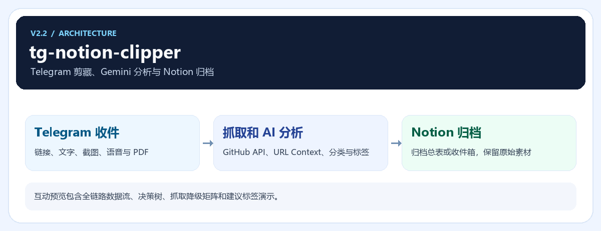

# tg-notion-clipper

一个可部署在 Google Cloud Run 上的 **Telegram → Gemini → Notion** 个人知识剪藏助手。

转发链接、文字、截图、语音或 PDF 到 Telegram Bot，就能把素材、批注、标签和摘要归档到 Notion。遇到页面受限或 AI 暂不可用时，机器人保留可用的原始内容和错误说明，供后续整理。

## V2.2 架构预览

[](https://wu0ming.github.io/tg-notion-clipper/)

[打开互动架构图 →](https://wu0ming.github.io/tg-notion-clipper/) · [备用互动预览](https://htmlpreview.github.io/?https://github.com/wu0ming/tg-notion-clipper/blob/main/docs/index.html)

## 核心特性

- **链接抓取**（[`router.py`](router.py)）
  - **GitHub**：仓库语言、Stars、Forks、主题、许可证和 README，也支持文件、分支、Issue 和 PR 链接。公开链接可匿名读取，`GITHUB_TOKEN` 可选。
  - **X / Twitter**：FxTwitter API（支持正文、引用推文、X 长文 Article、图片）→ 通用读取链
  - **V2EX**：官方话题 & 评论 API（主帖 + 前 20 条评论）→ 通用读取链
  - **微信公众号**：模拟微信客户端直连解析（修复 `data-src` 懒加载、代码块行号错位、`wsrv.nl` 图片代理绕过防盗链、识别已删除/违规/小绿书）→ 通用多渠道兜底
  - **Reddit**：官方 OAuth（可选）→ 公开 JSON → 通用读取链
  - **通用网页**：优先消耗月度刷新免费额度的抓取链 **`Tavily Extract → Firecrawl → ZenRows → Jina Reader → 直连 HTML`**
  - **Gemini 联网**：常规渠道耗尽后，由 URL Context 读取原始链接。只有 Gemini 确认读取成功时才归档其提取结果，无法核实的链接进入收件箱。
- **媒体归档**（[`telegram_media.py`](telegram_media.py)）
  - 图片识别文字，语音和音频转写，PDF 提取文字与要点。附带的批注与媒体一起分析。Telegram Bot API 下载上限为 20 MB，Notion 能接收的附件大小还取决于它所在工作区的套餐。
- **Notion 动态分类配置**（[`category_config.py`](category_config.py)）
  - 在「分类配置」表中编辑分类和建议标签，5 分钟内刷新，也可以发 `/reload` 立即刷新。建议标签按语义匹配，消息里手动写的 `#标签` 优先保留。
- **URL 预查重 & 幂等写入**（[`app.py`](app.py) & [`notion_writer.py`](notion_writer.py)）
  - 自动剥离追踪参数（`utm_*`、`fbclid`、微信会话参数等）并展开短链，在抓取和调用 LLM 前先查 Notion 去重，省时省钱
- **Gemini 分析与留档**（[`gemini_processor.py`](gemini_processor.py)）
  - 先按动态分类规则生成结构化结果，必要时切换模型并尝试普通 JSON。分析仍不可用时，以 `AI_PENDING` 状态保存原始素材。
- **逐条进度**（[`app.py`](app.py)）
  - 每条消息显示处理状态，最终回执引用原消息并附 Notion 链接。
- **低成本 Serverless 部署**（[`deploy.ps1`](deploy.ps1) & [`Dockerfile`](Dockerfile)）
  - 按请求计费（`--cpu-throttling`），`min-instances=0` 空闲零费用；Secret Manager + Artifact Registry 清理策略 + 可选预算告警

---

## 快速开始

### 浏览器剪藏

1. 在 Chrome 或 Vivaldi 的 Tampermonkey 中打开[安装脚本](https://raw.githubusercontent.com/wu0ming/tg-notion-clipper/main/browser/tg-notion-clipper.user.js)。
2. 私聊 Bot 并发送 `/clipkey`。在脚本菜单选择「配置配对码」，粘贴 Bot 返回的配对码。配对码有效期为 180 天。
3. 打开网页，点右下角「剪藏」选择整页正文或选区。可以编辑批注，也可以多次选择段落并点「保存选区批注」，最后随整页发送。油猴菜单还有「一键剪藏整页」和「一键剪藏选区」。

浏览器把 Markdown、原始地址和批注发送到 Cloud Run 的 `POST /clip`。Notion 父页保留来源、摘要和批注，完整文章排版在可点击的「剪藏原文」子页面。浏览器也可以独立下载 Markdown。脚本配对码只用于提交剪藏。

自部署时，将脚本的 `endpoint` 和 `@connect` 修改为自己的服务域名。现有 Notion 归档表可增加 `ClipKey` 文本列，同一网页可以保存不同选区，完全相同的剪藏可查重。单次提交支持 18 万字符 Markdown 和 8,000 字符批注，JSON 总大小上限为 480 KiB。

脚本内嵌了 [MarkDownload](https://github.com/deathau/markdownload/tree/7e8cc1a2156a5b413db133677641c3f8a23cd39d) 使用的 Mozilla Readability、Turndown 和 GFM 扩展。依赖版本和许可证保留在脚本中。

### 1. 准备环境与密钥

```bash
python -m venv .venv
# Windows
.venv\Scripts\pip install -r requirements.txt
# macOS / Linux
.venv/bin/pip install -r requirements.txt
```

复制 `.env.example` 为 `.env`，填写核心配置：
- `TELEGRAM_BOT_TOKEN`：通过 `@BotFather` 创建 Bot 获取
- `GEMINI_API_KEY`：Google AI Studio API Key，开启摘要、分类、联网和多模态分析。留空时仍可归档可用的原始内容。
- `NOTION_TOKEN`：Notion Internal Integration Token（并将目标父页面授权给该 Integration）
- `NOTION_PARENT_PAGE_ID`：用于自动创建「归档总表」与「分类配置」表的 Notion 父页面 ID

可选抓取渠道密钥（按月刷新免费额度优先）：
- `TAVILY_API_KEY`：Tavily Extract（免费版每月 1,000 credits，约 5,000 页）
- `FIRECRAWL_API_KEY`：Firecrawl（免费版每月 1,000 credits）
- `ZENROWS_API_KEY`：ZenRows（免费版每月 5,000 credits，支持 JS 渲染重试）
- `JINA_API_KEY`：Jina Reader（提升限速，作为兜底）
- `GITHUB_TOKEN`：GitHub 只读令牌，可提高公开 API 请求配额

### 2. 初始化 Notion 数据库与 Telegram 白名单

```bash
# 一键创建 Notion「归档总表」和「分类配置」表并回填 .env
python setup_notion.py

# 给 Bot 发送任意消息后运行，自动获取并写入 ALLOWED_USER_ID
python setup_telegram.py
```

已部署的实例可继续使用原有 Notion 数据库。可以手动添加以下可选字段，或在新工作区运行 `python setup_notion.py --with-inbox` 创建相应结构。

| 设置 | 用途 |
| --- | --- |
| `NOTION_DB_INBOX` | 可选收件箱，采用与归档总表相同的列结构。留空时，失败素材进入归档总表。 |
| `InputType`、`FetchTier`（单选） | 在归档页表格中展示输入类型与抓取层级。 |
| `TelegramKey`（文本） | 按消息标识做跨进程的媒体去重。 |
| `建议标签`（多选或文本） | 在「分类配置」中配置命中该分类时优先参考的标签。`GLOBAL_SUGGESTED_TAGS` 可设置跨分类标签。 |

### 3. 本地测试与试跑

```bash
# 运行离线单元测试
python -m unittest discover -s tests -p 'test_*.py' -v

# 运行联网体检（验证各抓取渠道、Gemini、Notion 连通性）
python tests/live_check.py

# 本地长轮询试跑（无需公网域名）
python local_poll.py
```

### 4. 一键部署到 Google Cloud Run

前提：已安装 [Google Cloud CLI](https://cloud.google.com/sdk/docs/install) 并执行过 `gcloud auth login`，且 `.env` 中已填写 `GCP_PROJECT_ID`。

- **Windows**：双击 [`deploy.bat`](deploy.bat) 或运行 `powershell -ExecutionPolicy Bypass -File deploy.ps1`
- 部署脚本会自动完成：生成 `WEBHOOK_SECRET` → 启用 GCP API → 写入 Secret Manager → 构建部署 Cloud Run → 设置镜像清理策略 → 绑定 Telegram Webhook。

---

## Telegram 指令

| 指令 | 作用 |
| :--- | :--- |
| 发送任意链接 | 自动抓取、AI 分类整理并归档到 Notion |
| `链接 + 批注：你的内容` | 按个人批注归档。未标记的附言保存在「随附说明」 |
| 回复自己已归档的原消息，发送 `批注：你的内容` | 追加到原 Notion 页面。归档总表和独立收件箱需要 `TelegramKey` 文本列 |
| 发送纯文本 | 作为 `Note`（随手记）自动生成标题、标签并归档 |
| 发送图片、语音、音频或 PDF | 提取文字或转写，保存批注和可上传的原附件 |
| `#标签` | 将指定标签优先加入归档 |
| `/categories` | 查看当前启用的分类列表 |
| `/reload` | 立即强制从 Notion「分类配置」表刷新分类 |
| `/clipkey` | 私聊获取浏览器剪藏配对码 |
| `/id` | 查看当前 Telegram 数字 ID |
| `/help` | 查看使用说明 |

| 原消息表情 | 处理状态 |
| --- | --- |
| 👀 | 已收到，正在处理 |
| 👌 | 已归档 |
| 👍 | 已收录，跳过重复写入 |
| 🤔 | 使用联网补救或已降级留档 |
| 👎 | 归档失败，可重发原消息 |

---

## 项目结构

| 文件 | 说明 |
| :--- | :--- |
| `app.py` | FastAPI 入口：Webhook 鉴权、白名单、去重、指令处理、结构化日志 |
| `router.py` | 多平台 URL 路由与降级抓取引擎 |
| `gemini_processor.py` | Gemini 结构化分类、摘要、要点与超时/重试处理 |
| `telegram_media.py` | Telegram 附件识别与有大小限制的流式下载 |
| `category_config.py` | 读取并缓存 Notion「分类配置」表（5 分钟 TTL，失败兜底 `rules.yaml`） |
| `notion_writer.py` | Notion REST API（`2025-09-03`）写入、URL 查重、长文切片 |
| `utils.py` | 纯函数工具：URL 提取/归一化、微信图片代理、Notion Block 组装 |
| `config.py` | 环境变量与 `.env` 加载 |
| `rules.yaml` | 初始分类种子与兜底规则 |
| `setup_notion.py` / `sync_categories.py` / `setup_telegram.py` | 初始化与分类同步脚本 |
| `local_poll.py` / `set_webhook.py` | 本地长轮询调试与 Webhook 管理 |
| `deploy.bat` / `deploy.ps1` / `Dockerfile` | Cloud Run 一键部署与容器配置 |
| `tests/` | 离线单元测试与联网体检脚本 |

## License

[MIT](LICENSE)
